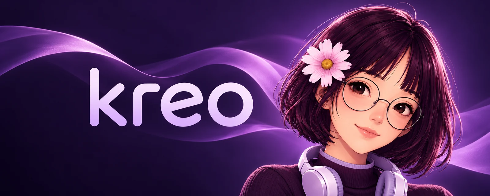

<p align="center">
  
</p>

<h1 align="center">Kreo</h1>

<p align="center">
  A Discord music bot with a purple, responsive dashboard.<br />
  Find a track, build a queue, and keep your server listening together.
</p>

<p align="center">
  <a href="./package.json"></a>
  <a href="./package.json"></a>
  <a href="./dashboard/package.json"></a>
  <a href="./LICENSE"></a>
</p>

<p align="center">
  <a href="#quick-start">Quick start</a> ·
  <a href="./SETUP_GUIDE.md">Full setup guide</a> ·
  <a href="#how-it-fits-together">Architecture</a> ·
  <a href="./LICENSE">License</a> ·
  <a href="./docs/Kreo-Copyright-Notice.pdf">Copyright notice (PDF)</a>
</p>

> **Copyright notice:** [View or download the PDF](./docs/Kreo-Copyright-Notice.pdf)
> issued by **Dev Bhakat / rock-forge**, or [read the text version](./COPYRIGHT-NOTICE.md).

## What you get

| Discord bot | Web dashboard |
| --- | --- |
| Prefix and slash music commands | Discord login and server selection |
| Search, queue, pause, skip, seek, volume, and filters | Search and playback controls with live player updates |
| Liked tracks, playlists, and listening history | Personal liked songs and playlists |
| 24/7 configuration and connection recovery | Server settings, pinned servers, and recent rooms |
| Category help, owner controls, and application emoji support | Purple theme, desktop artwork, and mobile navigation |

The bot uses discord.js, Kazagumo, and Shoukaku with a Lavalink v4 node. The dashboard uses Next.js, React, and Discord OAuth. MongoDB stores persistent settings and music collections.

**Music plays in Discord voice channels.** The dashboard controls the bot; it does not stream music through your browser. Join a voice channel in the selected server before adding music. When a player is already active, join the bot's voice channel to control it.

## Quick start

Use **Node.js 24**, matching the included dashboard Docker image. You also need MongoDB, a Lavalink v4 node with your chosen search source enabled, and a Discord application with a bot token and OAuth credentials. You provide and operate those services.

### 1. Get the source and install dependencies

```sh
git clone https://github.com/rock-forge/Kreo.git
cd Kreo
npm ci
npm ci --prefix dashboard
```

### 2. Create your local configuration

**Windows PowerShell**

```powershell
Copy-Item .env.example .env
Copy-Item dashboard/.env.example dashboard/.env.local
```

**Linux / macOS**

```sh
cp .env.example .env
cp dashboard/.env.example dashboard/.env.local
```

Fill in both files using the [environment reference](./SETUP_GUIDE.md#3-configure-the-environment). Set your Discord user ID in `OWNER_IDS`, use the same bridge secret in both files, and generate a different secret for NextAuth. Keep all real credentials out of commits.

In the Discord Developer Portal, enable **Server Members Intent** and **Message Content Intent**, then register this local OAuth redirect exactly:

```text
http://localhost:3000/api/auth/callback/discord
```

### 3. Build, then start

```sh
npm run build --prefix dashboard
npm start
```

Open [localhost:3000](http://localhost:3000), sign in with Discord, and select a server. Invite your bot, join a Discord voice channel, and search for a song. Run `/help` in Discord for the command menu. The prefix example is `>help` when using the supplied environment default; change it with `BOT_PREFIX`.

For development with dashboard hot reload:

```sh
npm run dev
```

For VPS hosting, HTTPS, or Pterodactyl, follow the [full setup guide](./SETUP_GUIDE.md). Production dashboard startup requires a completed build.

## How it fits together

```text
Browser ── Discord OAuth ── Next.js dashboard
   │                              │
   │ signed Socket.IO ticket      │ private, authenticated HTTP
   ▼                              ▼
Socket.IO proxy ──────────── Bot bridge / cluster manager
                                   │
                         Discord bot ── Lavalink
                                   │
                                MongoDB
```

The dashboard checks the signed-in user's server access before forwarding supported actions. The private bridge requires `DASHBOARD_BRIDGE_SECRET`; playback also checks Discord membership, voice-channel access, and blacklist state. Browser updates use short-lived, server-scoped Socket.IO tickets issued by the dashboard's authenticated `/api/socket` route. The shared bridge secret stays on the servers.

In production, keep the bridge HTTP API on a private connection and expose only the ticket-protected `/socket.io/` route through HTTPS. [Deployment examples](./SETUP_GUIDE.md#6-host-on-a-linux-vps) cover this arrangement.

## Commands and owner access

Use `/help` or your configured prefix followed by `help` to browse commands. Owners listed in `OWNER_IDS` can see and use owner commands. Discord administrator permission alone does not make someone a bot owner.

At startup, Kreo attempts to load emojis belonging to its own Discord application. Existing fallback icons remain available when custom application emojis are unavailable.

## Check your setup

```sh
npm test
npm run lint --prefix dashboard
npm run build --prefix dashboard
```

After supplying real service credentials, you can also run:

```sh
npm run check:services
```

This optional command connects to Discord, checks MongoDB access, and asks Lavalink for search results. It does not post Discord messages or modify stored data. Run it with awareness that it briefly opens a Discord gateway connection.

## Troubleshooting

| Symptom | Check |
| --- | --- |
| Login returns an OAuth callback error | Application ID/secret, exact redirect URL, `NEXTAUTH_URL`, and a fresh sign-in after changing configuration |
| Dashboard opens but cannot control music | Bot process, private API address, matching bridge secrets, and your Discord voice channel |
| A track cannot be resolved | Lavalink node credentials and support for `LAVALINK_SOURCE` |
| Player updates do not arrive | HTTPS Socket.IO proxy, `DASHBOARD_SOCKET_URL`, and allowed origins |
| Owner commands are hidden | Your own Discord user ID in `OWNER_IDS`, followed by a bot restart |
| Production dashboard will not start | Install dashboard dependencies and run its build first |

See the [detailed troubleshooting section](./SETUP_GUIDE.md#9-troubleshooting) for checks and deployment-specific guidance.

## License and third-party notices

Kreo is credited to **[rock-forge](https://github.com/rock-forge)**. This is a **source-available** release for normal noncommercial use under [LICENSE](./LICENSE). **Commercial use, resale, and public redistribution of modified versions require rock-forge's written permission.** Read the license for the complete permitted use, attribution requirements, and restrictions.

Third-party components remain subject to their own terms. See [THIRD_PARTY_NOTICES.md](./THIRD_PARTY_NOTICES.md) and the licenses distributed with the dependencies.

Read the [copyright notice](./COPYRIGHT-NOTICE.md) or download the
[notice PDF](./docs/Kreo-Copyright-Notice.pdf).
